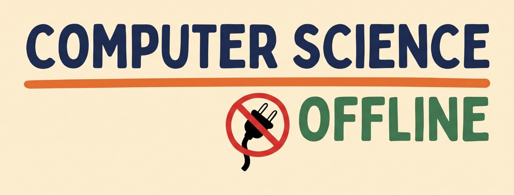

<p align="center">
  
</p>

**CS Offline** is a set of teacher and student resources for teaching computer science
without lots of technology. Every activity is **unplugged**: students use paper, cards, and each
other.

> Status: **planning, starting over** (November 2026). Only the decisions below are settled.

## Decided

| Decision | Notes |
|---|---|
| Name: **CS Offline** | Repo: `mrenne/csoffline` |
| Every activity is **unplugged** | Students use no technology. Teachers may print handouts |
| Six learning domains: **computer science, computational thinking, data science, AI literacy, cybersecurity, and ethics** | Every activity has one home domain |
| Audience: **middle and high school** (grades 6–12) | |
| License: **set per activity** | Nothing is Creative Commons unless its activity says so |

## System

CS Offline will be a website where students and educators explore six learning domains through
unplugged activities and resources, some of them games. Each activity has a home domain, and ideas connect activities across domains. See the [system spec](docs/system-spec.md) for the content model,
site structure, technical design, phases, and open decisions.

## Working on the site

The site is built with [Astro](https://astro.build/). You need Node.js 22 or later.

```bash
npm install
```

```bash
npm run dev
```

Then open http://localhost:4321/csoffline/. Content lives in `src/content/` (see the
[system spec](docs/system-spec.md), section 5). The build checks the content and stops with a
message if something is broken:

```bash
npm run build
```

The site is **not live**. GitHub Actions builds it on every push, but only deploys when started by
hand, after GitHub Pages is turned on (see `.github/workflows/site.yml`).

Current content is mostly placeholder: the six domains, five sample ideas, and entries for
the two games developed so far, **Data Science Deck** (a card game) and **Tokens TCG** (an AI
literacy trading card game), whose details are still to be filled in.

## Archive

An earlier version of this project, **Computation Quests**, is saved on the
`archive/computation-quests` branch (tag `archive-computation-quests`). It has a pixel-art map
of subject regions, a static website, map generators, templates, and unplugged activity ideas for
each topic. Nothing from it carries over unless it is brought back on purpose. To look at it:

```bash
git switch archive/computation-quests
```

## License

Licensing is set per activity. Content is under Creative Commons only where its activity says so.
The [LICENSE](LICENSE) file holds the CC BY-NC-SA 4.0 text for activities that use that license.
