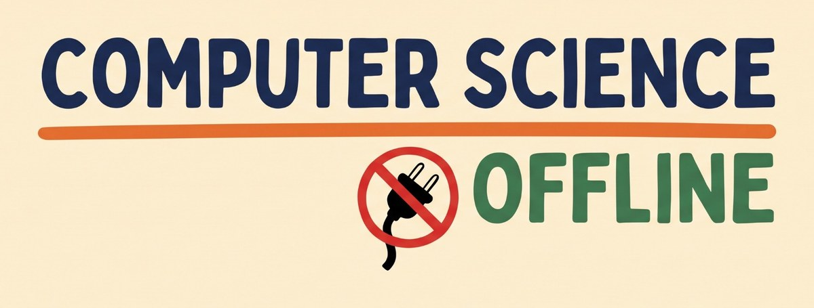

<p align="center">
  
</p>

**CS Offline** is a set of teacher and student resources for teaching computer science with little to no screen usage. Every activity is offline: students use paper, cardboard, cards, dice and, most importantly, each other.


> Status: **live** at https://www.csoffline.org/ (since November 2026), with activities still being added.

## Decided

| Decision | Notes |
|---|---|
| Name: **CS Offline** | Repo: `mrenne/csoffline` |
| Every activity is **unplugged** | Students use no technology. Teachers may print handouts |
| Six learning domains: **computer science, computational thinking, data science, AI literacy, cybersecurity, and ethics** | Every activity has one home domain |
| Audience: **middle and high school** (grades 6–12) | |
| License: **set per activity** | Nothing is Creative Commons unless its activity says so |

## System

CS Offline is a website where students and educators explore six learning domains through
unplugged activities and resources, some of them games. Each activity has a home domain, and ideas connect activities across domains. See the [system spec](docs/system-spec.md) for the content model,
site structure, technical design, phases, and open decisions.

## Working on the site

The site is built with [Astro](https://astro.build/). You need Node.js 22 or later.

```bash
npm install
```

```bash
npm run dev
```

Then open http://localhost:4321/. Content lives in `src/content/` (see the
[system spec](docs/system-spec.md), section 5). The build checks the content and stops with a
message if something is broken:

```bash
npm run build
```

The site is **live** at https://www.csoffline.org/, published with GitHub Pages. GitHub
Actions builds it on every push but only deploys when started by hand: in the Actions tab, choose
**Site**, then **Run workflow** with **Deploy to GitHub Pages** checked (see
`.github/workflows/site.yml`). From the command line:

```bash
gh workflow run site.yml -R mrenne/csoffline -f deploy=true
```

Current content includes the six domains, 14 ideas, and nine activities, among them
**Talent Stack: Data Science Edition** (a card game about data careers) and **Tokens TCG** (an AI
literacy trading card game).

## Archive

An earlier version of this project, **Computation Quests**, is saved on the
`archive/computation-quests` branch (tag `archive-computation-quests`). It has a pixel-art map
of subject regions, a static website, map generators, templates, and unplugged activity ideas for
each topic. Nothing from it carries over unless it is brought back on purpose. To look at it:

```bash
git switch archive/computation-quests
```

## License

Licensing is set per activity. Content is under Creative Commons only where its activity says so.
The [LICENSE](LICENSE) file holds the CC BY-NC-SA 4.0 text for activities that use that license.
